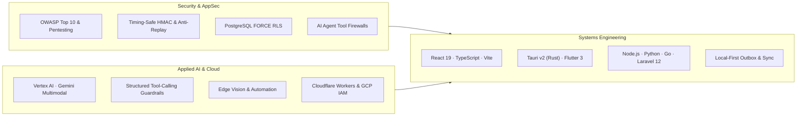

# Khalef Abdelmadjid (`@JARMID`)

**Ethical Hacker (Cisco Networking Academy) | AI & Full-Stack Systems Engineer | Algiers, Algeria**

I design resilient local-first applications, zero-trust payment backends, and deterministic AI security guardrails. Commercial client projects and proprietary venture systems remain strictly private; the repositories pinned below are standalone, clean-room MIT engineering primitives with zero external runtime dependencies.

[Portfolio](https://madjid-founder-portfolio.vercel.app) · [Credly Credentials](https://www.credly.com/users/khalef-abdelmadjid) · [Instagram (@jar.mid)](https://www.instagram.com/jar.mid/) · [Email](mailto:supamiarozo@gmail.com)

---

## Engineering Focus

---

## Pinned Open-Source Primitives

| Repository | Domain | Highlights |
| :--- | :--- | :--- |
| [**ai-agent-tool-firewall**](https://github.com/JARMID/ai-agent-tool-firewall) | AI & MCP Security | Dual-runtime Python 3.10+ & TypeScript 5+ zero-trust policy firewall blocking obfuscated SSRF, symlink/NTFS ADS traversal, CLI flag smuggling, and outbound secret exfiltration (`14/14` red-team tests). |
| [**zero-trust-webhook-ledger**](https://github.com/JARMID/zero-trust-webhook-ledger) | Security & Fintech Backend | Constant-time raw-byte HMAC-SHA256 verification, replay-proof idempotency keys, and PostgreSQL 17 `FORCE ROW LEVEL SECURITY` double-entry SQL locks (`node --test`). |
| [**prompt-injection-checkout-guard**](https://github.com/JARMID/prompt-injection-checkout-guard) | Defensive AI Security | 22-vector red-team exploit harness (price override, NFKC/bidi smuggling, tool hijacking) paired with a deterministic server-side price-lock guardrail (`node --test`). |
| [**local-first-outbox-sync**](https://github.com/JARMID/local-first-outbox-sync) | Offline-First Systems | Crash-safe `fsync` append-only outbox queue with torn-write truncation, single-flight sync mutex, and idempotent reconnect replay (`node --test`). |

---

## Verified Credentials

- **Ethical Hacker (Cybersecurity & Pentesting)**, Cisco Networking Academy ([Verify on Credly](https://www.credly.com/badges/5c74a2c7-1073-4372-b039-4449229c5cb9/public_url))
- **Build a Secure Google Cloud Network**, Google Cloud ([Verify on Credly](https://www.credly.com/badges/e0aaa4dd-69d0-47b7-92fd-6b2cbedbcf7a/public_url))
- **Explore Generative AI with the Vertex AI Gemini API**, Google Cloud ([Verify on Credly](https://www.credly.com/badges/9ee52de1-cfef-428e-9779-3e39e0cffa9d/public_url))
- **Prompt Design in Vertex AI**, Google Cloud ([Verify on Credly](https://www.credly.com/badges/dc8181e9-b1a9-4193-99bd-9e6a8fcd4673/public_url))
- **Certified User: DaVinci Resolve 20**, Blackmagic Design (`ID: C66A-5405-7ACC-44D5`)

---

## Core Technical Stack

- **Languages:** TypeScript, JavaScript, Python, Rust, Go, Dart, PHP, SQL, C#, C++
- **Frontend & Cross-Platform:** React 19, Next.js, Tailwind CSS, Three.js WebGL, Flutter 3, Tauri v2
- **Backend & Data:** Node.js, Go, Laravel 12, PostgreSQL (RLS), SQLite, Redis, Cloudflare Workers
- **Security & Cloud:** OWASP Top 10, Kali Linux, Nmap, Burp Suite, Wireshark, Google Cloud (VPC/IAM), Docker, GitHub Actions

---

*Languages: Arabic (Native) · French (Bilingual) · English (Bilingual) · Open to remote engineering, AppSec, and AI systems roles.*
